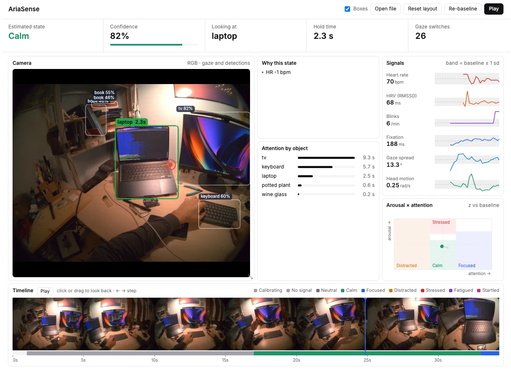
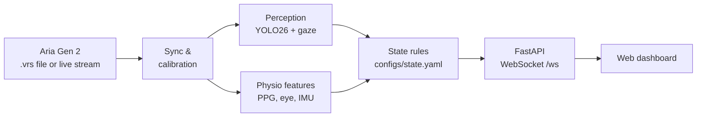

<div align="center">

# 👓 AriaSense

**See what you look at. Sense how you're doing.**

A live demo for [Meta Project Aria Gen 2](https://www.projectaria.com/) glasses that fuses gaze, object detection and physiological signals into a real-time estimate of the wearer's state.




<sub>The dashboard replaying a desk session: the wearer is <b>Calm</b> and has been looking at the laptop for 2.3 s.</sub>

</div>

## ✨ What it does

| | |
|---|---|
| 🎯 **What you're looking at** | YOLO detections on the RGB camera, with the object under your gaze highlighted and its hold time. |
| 💓 **How you're doing** | Heart rate, HRV, blinks, fixations, gaze spread and head motion from the glasses' sensors, z-scored against a personal baseline. |
| 🧠 **An estimated state** | Calm, Focused, Distracted, Stressed, Fatigued or Startled, with a confidence and the reasons behind it. |
| ⏪ **A scrubbable timeline** | Video thumbnails and the state over the whole session. Click or drag to look back at any moment. |
| 📡 **Recorded or live** | Develop and demo on `.vrs` recordings, then switch to the live stream from the glasses over USB or Wi-Fi. |

> [!NOTE]
> The states are *estimated* physiological and attentional states, not measured emotions.

## 🧩 How it works



## 🚀 Quick start

Requires [uv](https://docs.astral.sh/uv/) (Python 3.12 is pinned in `.python-version`).

```bash
uv sync
uv run ariasense dashboard data/s01_desk.vrs --baseline 60
```

Then open http://127.0.0.1:8000.

## 📚 Contents

- [Setup](#setup)
- [Usage](#usage)
- [Dashboard](#dashboard)
- [Live from the glasses](#live-from-the-glasses)
- [Development](#development)
- [Docs](#docs)

## Setup

Requires [uv](https://docs.astral.sh/uv/). Python 3.12 is pinned in `.python-version`.

```bash
uv sync
```

## Usage

Inspect a recording, i.e. list its streams, rates and available fields:

```bash
uv run ariasense inspect data/s01_desk.vrs
```

Append the report to the stream findings:

```bash
uv run ariasense inspect data/s01_desk.vrs -o docs/streams.md
```

Render the gaze dot and trail on the upright RGB video. Use it to check that the dot lands on what you looked at:

```bash
uv run ariasense overlay data/s01_desk.vrs -o runs/s01_overlay.mp4
```

Add `--show` for a live window and `--speed 1` to play back in real time.

Run YOLO26 detection and highlight the object you're looking at, with its dwell time:

```bash
uv run ariasense detect data/s01_desk.vrs -o runs/s01_detect.mp4
```

Weights are downloaded to `models/` on first use. Pick another model with `--model yolo26m.pt`. At the end, the command prints the time spent looking at each class.

Compute physiological and eye features once per second, z-scored against a personal baseline:

```bash
uv run ariasense physio data/s01_desk.vrs -o runs/s01_features.csv --baseline 60
```

The output is a CSV of raw values and z-scores, plus a PNG with each feature plotted against the baseline band. The features are:
- heart rate and HRV (RMSSD) from the PPG;
- blink rate, blink duration and PERCLOS;
- fixation duration, rate and ratio;
- gaze dispersion;
- head rotation and jerk;
- ambient light.

Estimate a state each second: Calm, Focused, Distracted, Stressed, Fatigued, or a Startled event. Each estimate comes with its confidence and the reasons behind it:

```bash
uv run ariasense states data/s02_states.vrs --labels data/s02_states_labels.csv
```

The rules and thresholds live in [configs/state.yaml](configs/state.yaml). With `--labels`, the command also prints a confusion matrix; see [docs/protocol.md](docs/protocol.md). These are *estimated* physiological and attentional states, not measured emotions.

### Dashboard

Replay a recording through the full pipeline and open the dashboard at http://127.0.0.1:8000:

```bash
uv run ariasense dashboard data/s01_desk.vrs --baseline 60
```

Or start an empty dashboard and pick the recording in the browser with **Open file**:

```bash
uv run ariasense dashboard
```

Open file lists the `.vrs` files under `data/` (change the folder with `--data-dir`), or takes any path on this machine. Opening a file replaces whatever is playing, including the live stream.

**Go live** (on by default) plays the file in real time. Turn it off in the Open file dialog, or pass `--no-live`, to analyse the whole file as fast as possible instead: the timeline spans the full recording from the start, fills in as it is processed, and you review it with click/drag, Play and the arrow keys.

```bash
uv run ariasense dashboard data/s01_desk.vrs --no-live
```

The dashboard shows:
- the camera view, with the gaze dot and trail, YOLO boxes, and the object you're looking at with its hold time;
- the estimated state, with its confidence and reasons, and the number of gaze switches between objects;
- an arousal × attention plane;
- live signal charts against the baseline band;
- attention time per object;
- a timeline along the bottom with video thumbnails and the state over the whole session.

Tech stack:
- **Backend:** [FastAPI](https://fastapi.tiangolo.com/) served by [uvicorn](https://www.uvicorn.org/). The pipeline's messages are pushed to the browser over a single WebSocket (`/ws`), and the controls (pause, speed, re-baseline, open file) are plain REST calls.
- **Frontend:** vanilla JavaScript, HTML and CSS, with no framework and no build step. The camera frames arrive as base64 JPEGs and are drawn with canvas overlays for the gaze dot, trail, YOLO boxes, arousal × attention plane and timeline.
- **Libraries:** [uPlot](https://github.com/leeoniya/uPlot) for the signal charts and [GridStack](https://gridstackjs.com/) for the draggable, resizable panels. Both are vendored in `src/ariasense/dashboard/static/vendor/`, so the dashboard works offline.

Click or drag on the timeline to stop following the live view and look back at any moment: the camera, state, signals and attention panels all show that time. Play runs the recording from there. Left/right arrows step 1 s (10 s with Shift), and Esc or the Live button returns to the live edge. Every frame is kept in a temporary file on disk while the dashboard runs, and a new loop of the replay starts a new recording.

Controls: Pause (space bar; while you look back it plays/pauses the recording, in sync with the timeline's Play), playback speed, Re-baseline, and a boxes toggle. By default the replay loops. Use `--no-loop` to play it once.

### Live from the glasses

Run the dashboard on the live stream from the glasses:

```bash
uv run ariasense live --interface usb
```

If both the pc and the glasses are connected to the same wifi:
```bash
uv run ariasense live --interface wifi_sta
```


Check which streams arrive, at what rate, and with what latency:

```bash
uv run ariasense stream-check
```

To test the live code path without the glasses, feed a recording through it with `--replay data/s01_desk.vrs`. Setup for USB, Wi-Fi and the glasses' hotspot is in [docs/live.md](docs/live.md).

## Development

```bash
uv run pytest
```

```bash
uv run ruff check . && uv run ruff format .
```

## Docs

- [docs/streams.md](docs/streams.md): which Gen 2 signals are available
- [docs/protocol.md](docs/protocol.md): recording and validation protocol
